# 架构

## 整体架构

```mermaid
flowchart TB
    subgraph Clients["客户端与入口"]
        User["用户"]
        Browser["Chrome / Firefox 扩展"]
        URL["lgom:// 外部协议"]
    end

    subgraph UIProcess["独立 UI 进程 (lgdm-ui)"]
        Fyne["Fyne UI<br/>窗口 / 设置 / 任务详情"]
        RPCClient["rpc.Client"]
        Fyne <--> RPCClient
    end

    subgraph BusinessProcess["业务进程"]
        Handoff["handoff<br/>127.0.0.1:17821+"]
        Launcher["urllauncher<br/>单实例锁 / URL 转发"]
        RequestEntry["请求落地<br/>URL / 扩展请求"]
        UIMgr["uimgr<br/>UI 会话管理"]
        Tray["tray<br/>托盘常驻"]
        RPC["internal/rpc<br/>gRPC / HTTP + token"]
        Service["appservice<br/>契约 Handler"]
        Scheduler["scheduler<br/>生命周期 / 并发 / FIFO"]
        Engine["engine<br/>分片 / Range / 重试"]
        Protocol["protocol<br/>协议驱动 / 代理 / PAC"]
        BT["bittorrent<br/>客户端 / DHT / 做种"]
        Store["store<br/>任务 / 设置 / 分片 / BT 元数据"]
        Settings["settings<br/>默认值与设置同步"]

        Handoff --> RequestEntry
        Launcher --> RequestEntry
        RequestEntry --> UIMgr
        RequestEntry -.->|"no-gui 直接入队"| Service
        UIMgr --> RPC
        UIMgr -.->|"拉起 / 复用"| Fyne
        Tray -.->|"显示窗口"| UIMgr

        RPC <--> Service
        Service <--> Scheduler
        Scheduler --> Engine
        Scheduler --> BT
        Engine --> Protocol
        BT --> Protocol
        Scheduler --> Store
        Settings --> Store
    end

    subgraph LocalResources["本地资源"]
        DB[("lgdm.sqlite")]
        Files["下载文件 / .part"]
        Runtime["config / logs / handoff.json"]
    end

    subgraph RemoteSources["外部下载来源"]
        Web["HTTP / HTTPS / WebDAV"]
        FTP["FTP"]
        Swarm["BitTorrent Swarm<br/>DHT / PEX / Tracker"]
    end

    User --> Fyne
    Browser --> Handoff
    Browser -.->|"客户端未运行时的回退"| URL
    URL --> Launcher
    RPCClient <-->|"Unix socket / TCP"| RPC
    Protocol --> Web
    Protocol --> FTP
    BT --> Swarm
    Store --> DB
    Engine --> Files
    BT --> Files
    Handoff --> Runtime
    Settings --> Runtime

    classDef clients fill:#e8f3ff,stroke:#2563eb,color:#111;
    classDef ui fill:#fff4d6,stroke:#d97706,color:#111;
    classDef business fill:#e9f8ee,stroke:#15803d,color:#111;
    classDef local fill:#f3e8ff,stroke:#7e22ce,color:#111;
    classDef remote fill:#feecec,stroke:#dc2626,color:#111;
    class User,Browser,URL clients;
    class Fyne,RPCClient ui;
    class Handoff,Launcher,RequestEntry,UIMgr,Tray,RPC,Service,Scheduler,Engine,Protocol,BT,Store,Settings business;
    class DB,Files,Runtime local;
    class Web,FTP,Swarm remote;
```



实线表示请求、调用和数据流，虚线表示进程生命周期或回退路径。浏览器扩展优先通过
本地回环端口提交 JSON；客户端未运行时才回退到 `lgom://`。任务确认后，UI 经 RPC
调用业务侧，`scheduler` 将普通下载交给 `engine`、BT 下载交给 `bittorrent`，
并把状态持久化到 SQLite 和任务文件。

## 进程模型

```text
             业务进程 lgdm（默认）
    store / scheduler / protocol / bittorrent
    托盘 / urllauncher / handoff / uimgr
                       │
                       │ 优先拉起同目录 lgdm-ui
                       ▼
              独立 UI 进程（Fyne）
                  rpc.Client
                       │
          internal/rpc：gRPC 或 net/http
          Unix socket 或 TCP + token

  旧安装包或只构建 lgdm 时：回退为自我复刻 + LDM_UI_CHILD=1
```

业务进程持有 SQLite、下载调度器、系统托盘和浏览器接力服务。`uimgr` 优先启动
同目录的独立 `lgdm-ui`，通过 `internal/rpc` 调用业务接口并接收事件流。独立 UI
不链接 store、scheduler、协议或 BitTorrent，避免为业务包级初始化重复占用内存。
UI 退出不影响下载任务，托盘可以再次拉起 UI。独立程序缺失时仍回退到旧行为。

## 分层

| 层 | 位置 | 职责 |
| --- | --- | --- |
| 契约层 | `internal/api` | DTO 与词汇表，定义业务方法的请求和响应 |
| 接口层 | `internal/rpc` | `Transport` / `Handler` / `Client` 与注册表 |
| 传输层 | `internal/rpc/httpx`、`internal/rpc/grpcx` | net/http JSON 与 gRPC server-streaming |
| 业务侧 | `internal/appservice` | 实现契约并把调用转给 scheduler/store |

默认传输是 gRPC。gRPC 契约权威源为 `proto/lgdm/v1/lgdm.proto`，通过
`scripts/gen_proto.sh` 重新生成。HTTP 传输提供 REST 风格路径、NDJSON 事件流和
内置 OpenAPI/Swagger UI。详细说明见 [UI RPC](../internal/rpc/README.md)。

## 模块目录

```text
cmd/lgdm-ui                独立 Fyne UI 入口
main.go                    业务进程入口
  ├── internal/store         SQLite 持久化
  ├── internal/scheduler     任务生命周期、状态、并发与 BT 编排
  ├── internal/engine        HTTP 分片规划、Range 下载与重试
  ├── internal/protocol      HTTP/HTTPS/FTP/WebDAV、代理与系统代理探测
  ├── internal/bittorrent    anacrolix/torrent 封装与种子元数据
  ├── internal/settings      设置默认值、持久化与跨模块同步
  ├── internal/autostart     Windows / Linux / macOS / Flatpak 自启
  ├── internal/logging       slog 门面、轮转文件和 Windows 控制台挂接
  ├── internal/api           UI/业务契约 DTO 与词汇表
  ├── internal/rpc           业务进程与 UI 子进程通信
  ├── internal/appservice    契约层 Handler 实现
  ├── internal/uimgr         UI 子进程与会话管理
  ├── internal/ui            Fyne 窗口与交互
  ├── internal/tray          常驻托盘
  ├── internal/urllauncher   lgom:// 解析、单实例锁与 URL 转发
  └── internal/handoff       浏览器扩展本地端口接力

installer/                  Windows MSI / EXE
flatpak/                    AppStream 元数据
scripts/                    构建、打包、测试与协议生成
.github/workflows/          桌面端与扩展 CI
lgom-extension/             Chrome / Firefox MV3 扩展
```

## 关键数据流

1. 用户从 UI、`lgom://` 或浏览器扩展提交下载请求。
2. 业务侧完成 URL 识别、探测、分片规划和任务持久化。
3. HTTP/FTP/WebDAV 任务进入 `internal/engine`；BitTorrent 任务进入
   `internal/bittorrent`。
4. `internal/scheduler` 管理等待、运行、暂停、失败、完成和做种状态。
5. 进度与状态经 RPC 事件流推送给 UI，静态状态持久化到 SQLite。

模块级设计见：

- [下载引擎](../internal/engine/README.md)
- [协议与代理](../internal/protocol/README.md)
- [BitTorrent](../internal/bittorrent/README.md)
- [调度器](../internal/scheduler/README.md)
- [任务存储与状态](../internal/store/README.md)
- [UI 进程](../internal/ui/README.md)
- [浏览器接力](../internal/handoff/README.md)
- [URL 协议](../internal/urllauncher/README.md)

已有的 RPC 设计与实施文档位于
[docs/superpowers/specs](superpowers/specs/2026-10-30-engine-rpc-layer-design.md) 和
[docs/superpowers/plans](superpowers/plans/2026-10-30-engine-rpc-layer.md)。
